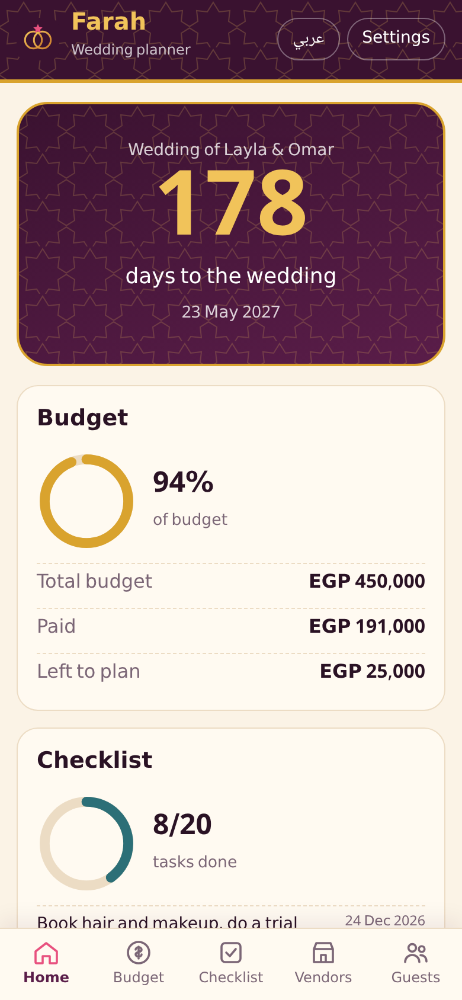
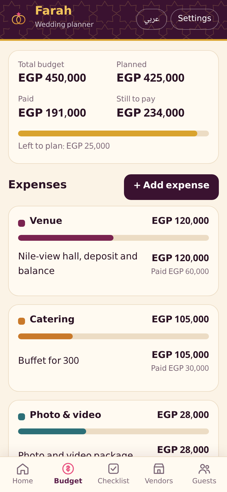
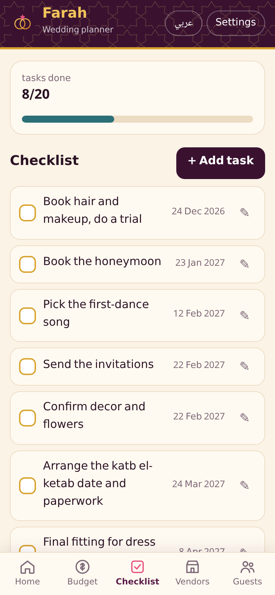
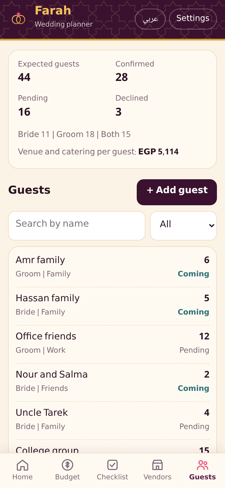

<p align="center"></p>

<h1 align="center">Farah | فرح</h1>

<p align="center"><b>An Egyptian wedding planner in your browser: budget, checklist, vendors and guest count.</b><br>
Arabic and English, right-to-left ready, built for the phone first.</p>

<p align="center"><a href="https://yousefkhames.github.io/farah/"><b>Open the live demo</b></a></p>

<p align="center">




</p>

## The pitch

Planning a wedding in Egypt means a hall deposit here, a zaffa band there, shabka, a photographer, a guest list that grows every week. Farah keeps it in one place. Set the date and the budget, and you get a countdown, a checklist with real due dates, a vendor book with call and WhatsApp buttons, and a guest count that shows what the hall and buffet cost per person.

## Features

- **Countdown and overview.** Days to the wedding, budget used, tasks done and expected guests on one screen.
- **Budget.** Expenses by category (venue, catering, photo, zaffa, shabka, home setup, honeymoon and more). Planned vs paid, remaining budget, and a clear warning when the plan goes over.
- **Checklist.** 19 steps for an Egyptian wedding, from booking the hall to tip envelopes. Due dates are worked out from your wedding date. Late tasks are flagged. Add your own tasks.
- **Vendors.** Name, category, price, status (idea, contacted, quoted, booked, paid) and notes. One tap to call or open WhatsApp (local `01...` numbers become `+20`).
- **Guests.** Families or groups with a head count, bride or groom side, and RSVP. Search, filter, and see confirmed, pending and declined totals. Export the list as CSV.
- **Cost per guest.** Venue plus catering divided by expected guests.
- **Arabic and English.** One tap to switch, with full RTL layout and Arabic numerals.
- **Backup.** Save and restore everything as a JSON file. Print a summary. Load sample data to try it.
- **Installable and offline.** A service worker caches the app after the first visit, so it opens and works without a connection and can be added to the home screen.

## Tech

Plain HTML, CSS and JavaScript. No framework, no build step, no server, no tracking, no dependencies. All logic is in `logic.js` (pure functions, unit tested). The UI is in `app.js`. Data is kept in `localStorage`. All user text is escaped before it is shown, and imported files are validated and clamped.

## Run it

Open `index.html`, or serve the folder with any static server:

```
python3 -m http.server 8000
```

## Tests

```
node test/logic.test.js     # unit tests, no install needed
node test/e2e.js            # click-through in headless Chrome (needs google-chrome)
node test/e2e.js https://yousefkhames.github.io/farah/   # same run against the live site
npm i puppeteer-core && node test/flow.js   # data flow: export, reset, import, junk and hostile files, replace-confirm (13 checks)
```

The click-through uses real mouse and keyboard events on a phone-sized screen: first run, settings, budget, checklist, vendors, guests, search and filters, language switch, reload persistence, corrupt storage, HTML-injection check, reset and sample data.

## Honest limits

- This is a demo hosted on GitHub Pages. It is not a service and has no accounts.
- Data lives in one browser on one device. Clearing site data erases it, and there is no sync between phone and laptop. Use the backup button.
- One wedding per browser. Amounts are in Egyptian pounds only.
- The checklist is a sensible default, not legal advice. Paperwork rules for katb el-ketab and the mazoun vary, so check with your local office.
- It does not send invitations or messages and does not take payments.
- Tested in headless Chrome. Other browsers are not tested.

## License

MIT. See [LICENSE](LICENSE).
